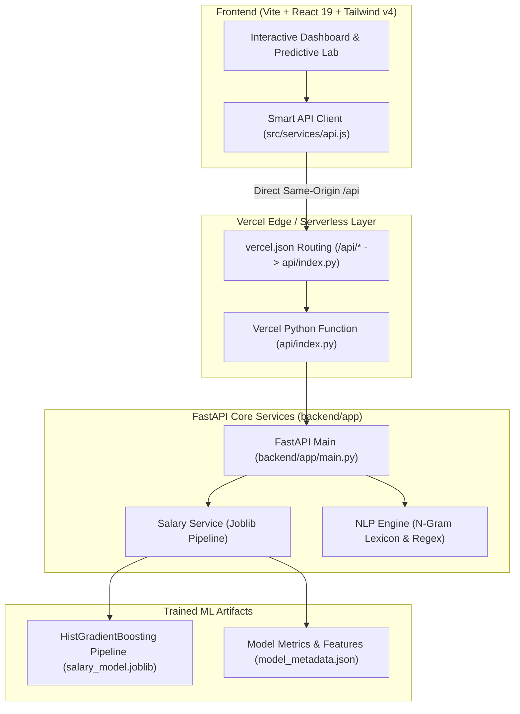

# JobInsight — AI-Powered Job Market Intelligence Platform

[](https://jobinsight-peach.vercel.app/)
[](https://python.org)
[](https://fastapi.tiangolo.com)
[](https://scikit-learn.org)
[](https://react.dev)
[](https://vitejs.dev)

JobInsight is a production-grade AI-powered job market intelligence and analytics platform. Built on **123,849 LinkedIn job postings** across North America, the platform couples interactive macroeconomic exploratory visualizations with a **genuine Scikit-Learn Machine Learning inference pipeline** for compensation regression and an **NLP entity extraction engine** for parsing arbitrary job descriptions.

- **Live Production URL:** [https://jobinsight-peach.vercel.app/](https://jobinsight-peach.vercel.app/)
- **GitHub Repository:** [https://github.com/UtsavChoudhary25/Jobinsight](https://github.com/UtsavChoudhary25/Jobinsight)
- **Google Colab (Phase 1 & 2 EDA):** [Colab Notebook](https://colab.research.google.com/drive/12gZ5TJsW5yFXXYcQWN8XYurIssWK6J7y?usp=sharing)
- **Phase 3 ML/NLP Training Notebook:** `notebooks/JobInsight_Phase3_ML_NLP.ipynb`

---

## Architecture Overview

JobInsight is engineered as a unified full-stack architecture with dual deployment flexibility:



---

## Machine Learning Pipeline (Salary Estimator)

The salary estimation engine replaces heuristic calculations with a Scikit-Learn regression pipeline trained on **35,237 disclosed salary records** extracted from 123,849 LinkedIn postings (`arshkon/linkedin-job-postings`).

### Preprocessing & Engineering
- **Outlier Mitigation:** Filtered to the 1st–99th percentile (\$130 – \$300,808/year).
- **Location Normalization:** State extraction and dynamic regional Cost-of-Living Index (COLI) assignment.
- **Categorical Encoders:** Robust `OneHotEncoder(handle_unknown='ignore')` applied to `formatted_work_type`, `formatted_experience_level`, and `state`.
- **Target Imputation:** Standardized compensation to annual median USD.

### Model Benchmark & Evaluation
Four regression architectures were trained and evaluated on an 80/20 train/test split (28,189 train / 7,048 test):

| Algorithm | Test MAE | Test RMSE | Test R² Score | Artifact Size | Selected |
| :--- | :---: | :---: | :---: | :---: | :---: |
| **HistGradientBoostingRegressor** | **\$30,482** | **\$41,039** | **0.3454** | **338 KB** | **Yes (Production)** |
| GradientBoostingRegressor | \$30,508 | \$41,062 | 0.3446 | 1.8 MB | Benchmark |
| RandomForestRegressor | \$30,557 | \$41,204 | 0.3401 | 42 MB | Benchmark |
| Ridge Regression (Alpha=1.0) | \$31,411 | \$41,821 | 0.3202 | 120 KB | Baseline |

### Confidence & Uncertainty Modeling
The model serves predictions accompanied by an empirical uncertainty range calculated from the test-set error distribution ($\pm 0.70 \times \text{MAE}$, approximately $\pm \$21,300$). Predictions clearly surface live training sample count ($N=35,237$) and test $R^2$ ($0.345$).

---

## NLP Skill & Requirement Extraction Engine

The NLP parser replaces hardcoded keyword matching with a dynamic phrase extraction engine:

- **Comprehensive Entity Lexicon:** 500+ normalized entities spanning 8 distinct categories:
  - *Programming Languages* (Python, TypeScript, Go, Rust, C++, Java, etc.)
  - *Frameworks & Libraries* (React, Next.js, PyTorch, TensorFlow, FastAPI, Django, etc.)
  - *Cloud & DevOps* (AWS, GCP, Azure, Kubernetes, Docker, Terraform, etc.)
  - *Databases & Storage* (PostgreSQL, MongoDB, Snowflake, Redis, BigQuery, etc.)
  - *Data & ML Tools* (Pandas, Spark, Airflow, Scikit-Learn, MLflow, etc.)
  - *Tools & Platforms* (Git, Linux, JIRA, Postman, etc.)
  - *Soft Skills* (Leadership, Stakeholder Management, Agile, Communication, etc.)
  - *Target Roles* (Machine Learning Engineer, Data Scientist, Full Stack Developer, etc.)
- **Multi-Word Phrase Matching:** Resolves composite technical tokens (e.g., "Natural Language Processing", "Continuous Integration", "Large Language Models") before unigrams.
- **Requirement Parsers:**
  - *Education Qualifications:* Regex detection of Ph.D., Master's, Bachelor's, Associate degrees and relevant majors.
  - *Experience Level:* Regex extraction of requested professional tenure (e.g., "5+ years", "3-5 years of experience").
- **Defensible Metrics:** Replaces arbitrary percentage confidence with honest **Entity Density** and **Category Coverage** indicators.

---

## API Endpoints

The backend is built with FastAPI and runs on both standalone ASGI servers and Vercel Serverless Functions.

### 1. `POST /api/predict-salary`
Estimates annual market compensation based on candidate and role attributes.

**Request:**
```json
{
  "role_category": "Software Engineering",
  "experience_level": "Mid-Senior level",
  "state": "CA",
  "work_type": "Full-time",
  "cost_index": 1.35
}
```

**Response:**
```json
{
  "estimated_median": 128450,
  "lower_bound": 107113,
  "upper_bound": 149787,
  "confidence_interval_usd": 21337,
  "model_version": "HistGradientBoosting-1.0",
  "features_used": {
    "role_category": "Software Engineering",
    "experience_level": "Mid-Senior level",
    "state": "CA",
    "work_type": "Full-time",
    "cost_index": 1.35
  },
  "training_samples": 35237,
  "r2_score": 0.3454,
  "mae": 30482
}
```

### 2. `POST /api/extract-skills`
Performs entity extraction on arbitrary raw job descriptions.

**Request:**
```json
{
  "job_description": "We are seeking a Senior Data Scientist with 5+ years of experience in Python, PyTorch, Docker, and AWS. Bachelor's in Computer Science required."
}
```

**Response:**
```json
{
  "total_entities_found": 6,
  "skills_by_category": {
    "Programming Languages": ["Python"],
    "Frameworks & Libraries": ["PyTorch"],
    "Cloud & DevOps": ["AWS", "Docker"],
    "Roles": ["Data Scientist"]
  },
  "all_skills": ["Python", "PyTorch", "Docker", "AWS", "Data Scientist"],
  "education_requirements": ["Bachelor's Degree"],
  "experience_requirements": ["5+ years"],
  "metrics": {
    "word_count": 23,
    "unique_categories": 4,
    "entity_density_percent": 26.1
  }
}
```

### 3. `GET /health`
Returns backend service health, runtime environment, and model loading status.

### 4. `GET /api/model-info`
Returns full hyperparameters, feature schemas, training sample counts, and evaluation metrics.

---

## Local Development & Setup

### Prerequisites
- Node.js (v18+)
- Python 3.10+
- npm

### 1. Frontend Setup
```bash
git clone https://github.com/UtsavChoudhary25/Jobinsight.git
cd Jobinsight
npm install
npm run dev
```

### 2. Backend Setup
```bash
cd backend
python -m venv venv
# On Windows:
venv\Scripts\activate
# On Linux/macOS:
source venv/bin/activate

pip install -r requirements.txt
uvicorn app.main:app --reload --port 8000
```

### 3. Run Automated Tests
```bash
python backend/test_api.py
```

---

## Deployment Options

### Option A: Vercel Full-Stack (Zero-Configuration, Deployed)
The repository is pre-configured with `vercel.json`, `api/index.py`, and root `requirements.txt`. Vercel automatically deploys the React SPA and serves the Python serverless ML functions at `/api/*` and `/health` under the exact same domain.

### Option B: Standalone Docker (Hugging Face Spaces / Render)
A production-ready `backend/Dockerfile` is included:
```bash
docker build -t jobinsight-backend -f backend/Dockerfile .
docker run -p 7860:7860 jobinsight-backend
```
Once deployed, set `VITE_API_URL=https://your-backend-url` in the frontend environment.

---

## Project Structure

```
Jobinsight/
├── api/                        # Vercel Serverless Functions
│   └── index.py                # Serverless bridge to FastAPI app
├── backend/                    # Core Python Backend
│   ├── app/
│   │   ├── main.py             # FastAPI entrypoint & CORS config
│   │   ├── routes/             # Endpoints (salary, nlp, health)
│   │   ├── services/           # ML inference & NLP matching logic
│   │   ├── schemas/            # Pydantic request/response models
│   │   └── models/             # Trained Joblib model & metadata JSON
│   ├── Dockerfile              # Container deployment for HF Spaces/Render
│   ├── requirements.txt        # Backend dependencies
│   ├── train_model.py          # Model training & evaluation pipeline
│   └── test_api.py             # Automated backend integration tests
├── notebooks/                  # Reproducible Jupyter/Colab notebooks
│   └── JobInsight_Phase3_ML_NLP.ipynb
├── src/                        # React Frontend (Vite)
│   ├── components/             # Dashboard tabs & UI components
│   │   ├── PredictiveLabTab.jsx # ML Salary Estimator & NLP Parser UI
│   │   ├── PipelineTab.jsx     # Data pipeline & ML benchmark audit
│   │   └── ...                 # Analytics, Overview, Geography tabs
│   ├── services/               # Frontend API client (src/services/api.js)
│   └── data/                   # Preprocessed analytics datasets
├── vercel.json                 # Vercel serverless routing configuration
├── requirements.txt            # Vercel Python runtime dependencies
└── package.json                # Frontend scripts and dependencies
```

---

## License & Credits

Dataset sourced from the **LinkedIn Job Postings (2023–2024)** dataset on Kaggle (`arshkon/linkedin-job-postings`). Built and maintained by [Utsav Choudhary](https://github.com/UtsavChoudhary25).
