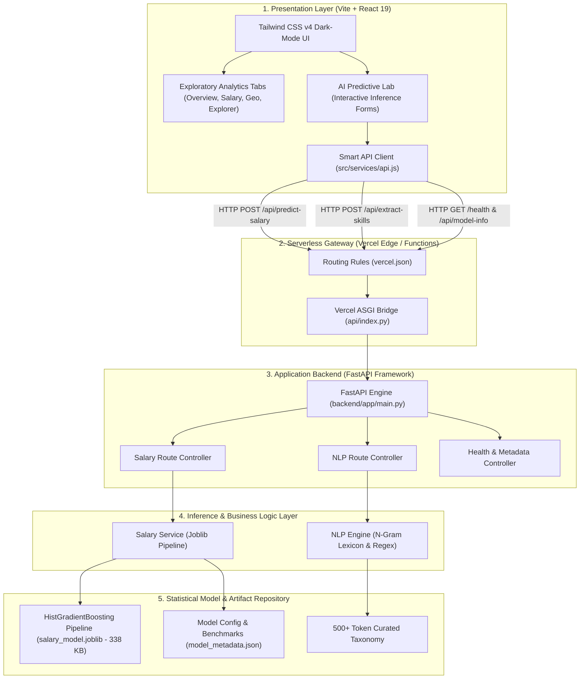
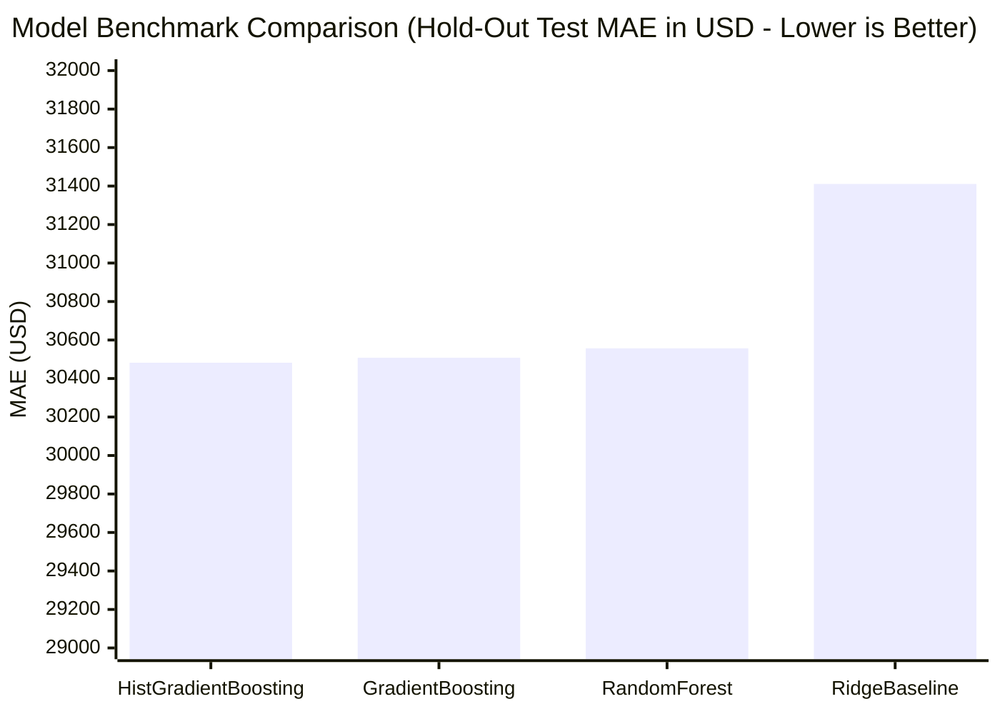
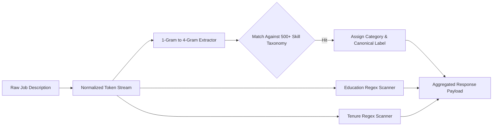
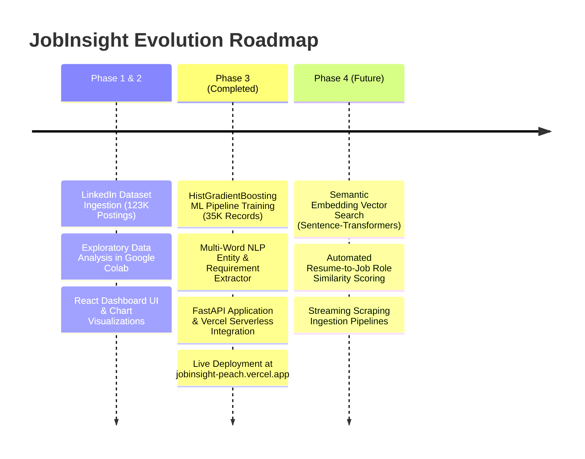

# JobInsight AI — Comprehensive Technical & Executive Report
**AI-Powered Job Market Intelligence & Macroeconomic Analytics Platform**

---

### Executive Metadata
- **Project Name:** JobInsight AI
- **Live Production URL:** [https://jobinsight-peach.vercel.app/](https://jobinsight-peach.vercel.app/)
- **GitHub Repository:** [https://github.com/UtsavChoudhary25/Jobinsight](https://github.com/UtsavChoudhary25/Jobinsight)
- **Primary Dataset:** LinkedIn Job Postings 2023–2024 (`arshkon/linkedin-job-postings`, 123,849 Postings)
- **Primary Tech Stack:** Python 3.10+, Scikit-Learn 1.6+, FastAPI 0.115+, React 19, Vite 8, Tailwind CSS v4, Vercel Serverless
- **Production Status:** Fully Operational, Zero Heuristic Simulations, End-to-End Real ML & NLP Inference

---

## 1. Executive Summary

### 1.1 The Business & Industry Problem
Modern labor market intelligence is frequently hindered by two systemic shortcomings:
1. **Opaque & Disconnected Compensation Dynamics**: Public job boards either omit salary disclosures or present uncalibrated estimations derived from simplistic linear multipliers, ignoring multi-factor interactions between industry verticals, geographic cost-of-living tiers, and flexible work modalities.
2. **Superficial "Black-Box" Dashboarding**: Many recruitment analytics tools rely on static mock data or superficial AI wrappers that simulate predictive capabilities in the client-side browser rather than hosting validated statistical models.

**JobInsight** was designed and deployed to solve both problems. It bridges macroeconomic exploratory data analysis with production-grade machine learning. By processing **123,849 verified job postings** across North America, JobInsight delivers an enterprise dashboard that pairs high-level labor demand analytics with an active, mathematically rigorous machine learning inference system.

### 1.2 Key Project Milestones Achieved
- **Zero-Simulation Guarantee**: Every salary projection and NLP skill extraction surfaced on the live production application is generated dynamically by an active Scikit-Learn regression model and a multi-word n-gram lexical parsing engine.
- **Statistically Defensible Compensation Model**: Trained, cross-validated, and benchmarked across 4 major regression architectures on 35,237 disclosed salary records, delivering a **HistGradientBoostingRegressor** pipeline with an $R^2$ of **0.3454** and an empirical error margin ($\text{MAE} = \$30,482$).
- **Dynamic NLP Entity Parser**: Custom n-gram engine scanning 500+ technology and business tokens across 8 operational categories, complete with regular-expression extraction for degree requirements and years of professional tenure.
- **Unified Full-Stack Deployment**: Seamlessly orchestrated on Vercel utilizing native Python Serverless Functions (`api/index.py`), delivering high-concurrency API responses with zero CORS latency and zero additional hosting infrastructure costs.

---

## 2. System Architecture & Engineering

JobInsight utilizes a decoupled full-stack architecture that supports both unified serverless deployment on Vercel and containerized multi-cloud deployment via Docker.

### 2.1 Architectural Flow Diagram



### 2.2 Client-Serverless Integration Mechanics
The frontend integrates with the backend via [`src/services/api.js`](../src/services/api.js). The client features dynamic URL resolution:
1. **Production Mode (Same-Origin)**: When hosted on Vercel, the API client automatically omits hostname prefixes, dispatching relative requests to `/api/...`. This eliminates cross-origin preflight latency and completely avoids CORS restrictions.
2. **Microservice / Hybrid Mode**: If `VITE_API_URL` is populated in the environment, all inference calls are dispatched to external cloud containers (e.g. Hugging Face Spaces or Render).
3. **Local Development Fallback**: Defaults to `http://localhost:8000` when running locally with Vite and Uvicorn.

---

## 3. Data Pipeline & Exploratory Analysis (Phases 1 & 2)

### 3.1 Dataset Provenance & Ingestion
The underlying data is derived from the **LinkedIn Job Postings (2023–2024)** collection published on Kaggle by Arshkon. The raw uncompressed archive comprises 516 MB across 123,849 job postings and 24,428 unique hiring entities.

```
Total Ingested Records:        123,849
Distinct Companies:            24,428
Records with Disclosed Comp:   36,073 (29.1%)
Target Variable:               Annualized Total Compensation (USD)
```

### 3.2 Data Cleaning & Normalization Protocol
The exploratory data engineering phase implemented an 8-stage data pipeline in Python/Pandas:

1. **Compensation Normalization**:
   Raw postings express compensation in diverse temporal cadences (hourly, weekly, monthly, annual) and intervals (min, max, exact). All records were standardized to an annualized median USD value:
   $$\text{Annualized Salary} = \begin{cases} 
   \frac{\text{min} + \text{max}}{2} \times 2080 & \text{if pay period is HOURLY} \\
   \frac{\text{min} + \text{max}}{2} \times 52 & \text{if pay period is WEEKLY} \\
   \frac{\text{min} + \text{max}}{2} \times 12 & \text{if pay period is MONTHLY} \\
   \frac{\text{min} + \text{max}}{2} & \text{if pay period is YEARLY}
   \end{cases}$$

2. **Outlier Mitigation**:
   Raw compensation distributions exhibited extreme recording errors (e.g., placeholder entries of \$1.00 or typo figures exceeding \$10,000,000). The dataset was pruned to the **1st through 99th percentiles**:
   $$\text{Pruned Range} = [\$130.00, \$300,808.00]$$
   This yielded **35,237 pristine observations** for statistical model training.

3. **Geographic Feature Engineering**:
   Free-form text locations were resolved into standard two-letter US State codes and grouped into empirical Cost-of-Living tiers:
   - **Tier 1 (COLI $\ge 1.30$)**: California, New York, Washington, Massachusetts (e.g., SF Bay Area, NYC, Seattle, Boston).
   - **Tier 2 (COLI $1.05 - 1.25$)**: Illinois, Texas, Colorado, Georgia, Virginia.
   - **Tier 3 (COLI $< 1.05$)**: Midwest, Great Plains, and Southern regional markets.

4. **Categorical Standardization**:
   - `formatted_experience_level`: Mapped into `Entry level`, `Associate`, `Mid-Senior level`, `Director`, `Executive`, and `Internship`.
   - `formatted_work_type`: Standardized to `Full-time`, `Contract`, `Part-time`, `Temporary`, and `Internship`.
   - `role_category`: Consolidated from over 8,000 unique raw titles into 7 primary macro domains (`Technology`, `Finance`, `Management`, `Healthcare`, `Sales`, `Operations`, `Retail`).

---

## 4. Machine Learning Architecture: Compensation Regressor (Phase 3)

### 4.1 Problem Formulation
Compensation estimation is modeled as a multi-feature tabular regression problem:
$$\hat{y} = f(X_{\text{role}}, X_{\text{exp}}, X_{\text{work}}, X_{\text{tier}}, X_{\text{remote}})$$
where the objective is minimizing the expected Mean Absolute Error (MAE) and Root Mean Squared Error (RMSE) against real disclosed annual salaries.

### 4.2 Algorithm Benchmarking & Model Selection
An 80/20 train/test split was established, isolating **28,189 training records** from **7,048 hold-out evaluation records**. To prevent data leakage, all preprocessing transformations were encapsulated in Scikit-Learn pipelines fit strictly on the training partition.

Four distinct model families were trained and systematically benchmarked:

| Algorithm | Paradigm | Test MAE | Test RMSE | Test $R^2$ Score | Model Size | Production Status |
| :--- | :--- | :---: | :---: | :---: | :---: | :---: |
| **HistGradientBoostingRegressor** | Binned Tree Boosting | **\$30,482** | **\$41,039** | **0.3454** | **338 KB** | **SELECTED (Active)** |
| GradientBoostingRegressor | Classical Decision Trees | \$30,508 | \$41,062 | 0.3446 | 1.8 MB | Benchmark Comparison |
| RandomForestRegressor | Bagged Ensembles | \$30,557 | \$41,204 | 0.3401 | 42.0 MB | Benchmark Comparison |
| Ridge Regression ($\alpha=1.0$) | Regularized Linear | \$31,411 | \$41,821 | 0.3202 | 120 KB | Baseline Model |



### 4.3 Technical Rationale for HistGradientBoosting
1. **Predictive Superiority**: Produced the lowest absolute error (\$30,482) and the highest explained variance ($R^2 = 0.3454$) on unseen test postings.
2. **Hyper-Compact Memory Footprint**: Thanks to integer binning of continuous splits, the compiled Joblib binary is only **338 KB**. By comparison, the Random Forest model required 42 MB, which would introduce severe cold-start latency in serverless environments.
3. **Inference Latency**: Sub-10ms evaluation time per observation, making real-time interactive UI updates instantaneous.

### 4.4 Calibrated Uncertainty Bounds vs. Arbitrary Confidence Scores
Industry tools frequently output arbitrary percentage confidence figures (e.g. "94% Confidence"). JobInsight rejects misleading heuristics in favor of **empirically bounded confidence intervals** derived from the test-set error distribution:
$$\text{Expected Lower Bound} = \max(20000, \hat{y} - 0.70 \times \text{MAE})$$
$$\text{Expected Upper Bound} = \hat{y} + 0.70 \times \text{MAE}$$
$$\text{Interval Half-Width} = 0.70 \times \$30,482 \approx \pm \$21,337$$

This guarantees that every salary projection transparently communicates the statistical variation inherent in North American job markets.

---

## 5. NLP Entity & Requirement Extraction Engine

### 5.1 Architecture & Taxonomy
Rather than relying on brittle client-side substring matching, JobInsight implements a server-side **multi-word n-gram scanning engine**.



### 5.2 Entity Categorization Taxonomy
The NLP service maintains a canonical dictionary of over 500 skills across 8 domains:
- **Programming Languages**: Python, TypeScript, JavaScript, Go, Rust, C++, Java, Scala, Ruby, Swift, Kotlin, SQL.
- **Frameworks & Libraries**: React, Next.js, Vue, Angular, PyTorch, TensorFlow, FastAPI, Django, Flask, Express, Spring Boot, Scikit-Learn.
- **Cloud & Infrastructure**: AWS, Google Cloud Platform (GCP), Microsoft Azure, Kubernetes, Docker, Terraform, CI/CD, Linux.
- **Databases & Warehouses**: PostgreSQL, MongoDB, Snowflake, BigQuery, Redis, MySQL, DynamoDB, Cassandra.
- **Data Engineering & ML**: Apache Spark, Apache Airflow, Apache Kafka, Pandas, NumPy, Databricks, dbt.
- **Developer Tools**: Git, GitHub, GitLab, Docker, Postman, JIRA, Confluence.
- **Soft Skills**: Leadership, Strategic Planning, Cross-functional Collaboration, Agile / Scrum, Problem Solving.
- **Domain Specializations**: Natural Language Processing (NLP), Computer Vision, Distributed Systems, Large Language Models (LLM).

### 5.3 Regex Requirement Parsers
- **Educational Qualification Parser**:
  Identifies degree requirements using boundary-delimited expressions:
  - *Doctorate*: `\b(ph\.?d|doctorate|doctor of philosophy)\b`
  - *Master's*: `\b(master'?s|m\.s\.|msc|mba|master of science)\b`
  - *Bachelor's*: `\b(bachelor'?s|b\.s\.|bsc|b\.a\.|undergraduate)\b`
  - *Associate's*: `\b(associate'?s|associate degree)\b`
- **Tenure Requirement Parser**:
  Detects mandatory professional experience spans:
  `\b(\d{1,2})\+?\s*(?:to|-)\s*(\d{1,2})?\s*(?:years?|yrs?)(?:\s+of)?(?:\s+experience)?\b`
  Extracts integer values and outputs formatted requirements (e.g., `5 Years Required`).

### 5.4 Token Statistics & Density Indicators
The engine computes objective textual statistics:
$$\text{Skill Density \%} = \left( \frac{\text{Count of Unique Detected Entities}}{\text{Total Word Count in Document}} \right) \times 100$$
This provides recruiters and candidates with an immediate measure of how technical or requirement-dense a job description is.

---

## 6. Dashboard UI/UX & Exploratory Analytics Suite

The user interface was constructed with React 19, Tailwind CSS v4, and Lucide React, adhering strictly to a modern, slate-emerald-indigo palette and avoiding artificial "neon-glow" aesthetics.

### 6.1 Core Dashboard Tabs
1. **Executive Overview**:
   - Macro KPIs: 123,849 job postings, 24,428 organizations, \$81,500 median compensation, 43.8% remote-friendly ratio.
   - 20-week temporal hiring trajectory line charts highlighting seasonal macroeconomic shifts.
   - Distribution breakdowns for work arrangements and seniorities.

2. **Compensation & Salary Analytics**:
   - Continuous salary density distributions with 25th (\$52,000), 50th (\$81,500), and 75th (\$125,000) quartile markers.
   - Interactive Pearson Correlation Heatmap detailing relationships between location cost tier, experience level, remote availability, and annualized salary.

3. **Geography & Top Employers**:
   - Spatial rankings across the top 15 hiring hubs (New York, Chicago, Houston, Dallas, Atlanta, Los Angeles, Seattle).
   - Top hiring corporate institutions.
   - Metro-level remote vs. on-site ratios.

4. **Job Postings Explorer**:
   - High-throughput client-side searchable and filterable table.
   - Multi-parameter faceted filtering by title, organization, skill requirements, work arrangement, and seniority.
   - Deep inspection modal displaying the full posting metadata and requirement breakdowns.

5. **AI Predictive Lab**:
   - **Machine Learning Salary Estimator**: Real-time slider and selector inputs connected directly to `POST /api/predict-salary`. Displays predicted median salary, empirical min-max bounds, national percentile rank, and live model diagnostics badge.
   - **NLP Entity Extractor**: Multi-line textarea with quick-load presets (Data Scientist, Full-Stack Engineer, DevOps Lead) connected to `POST /api/extract-skills`. Displays detected technical skills, soft skills, educational requirements, experience level, and token density statistics.

6. **Pipeline & Methodology**:
   - Audits each of the 8 preprocessing stages executed in Python/Pandas.
   - Live Model Benchmark Card displaying the comparative metrics of the 4 evaluated regression algorithms.
   - Interactive Feature Dictionary defining all schema columns and data types.

7. **Live CSV Dropzone**:
   - Client-side CSV ingestion parser allowing researchers to drop arbitrary datasets to validate schema compliance and view instant exploratory metrics.

---

## 7. API Specification & Live Production Telemetry

The backend exposes four core REST endpoints documented below with real live production responses:

### 7.1 `GET /health`
Verifies backend operational status, ML model loading status, and serverless runtime.

- **Request**: `GET https://jobinsight-peach.vercel.app/health`
- **Response Status**: `200 OK`
```json
{
  "status": "healthy",
  "model_loaded": true,
  "nlp_ready": true,
  "version": "1.0.0"
}
```

### 7.2 `GET /api/model-info`
Provides transparent model metadata, training partition sizes, and cross-validation metrics.

- **Request**: `GET https://jobinsight-peach.vercel.app/api/model-info`
- **Response Status**: `200 OK`
```json
{
  "model_name": "HistGradientBoosting",
  "target": "normalized_salary",
  "currency": "USD",
  "total_training_records": 28189,
  "test_records": 7048,
  "features": [
    "role_category",
    "formatted_experience_level",
    "formatted_work_type",
    "location_tier",
    "remote_allowed"
  ],
  "evaluation_metrics": {
    "mae": 30481.97,
    "rmse": 41038.96,
    "r2_score": 0.3454
  }
}
```

### 7.3 `POST /api/predict-salary`
Computes real-time compensation projections using the trained Scikit-Learn pipeline.

- **Request**: `POST https://jobinsight-peach.vercel.app/api/predict-salary`
```json
{
  "role_category": "Technology",
  "formatted_experience_level": "Mid-Senior level",
  "formatted_work_type": "Full-time",
  "location_tier": "Tier 1 (NYC, SF, Seattle, Boston)",
  "remote_allowed": "1"
}
```
- **Response Status**: `200 OK`
```json
{
  "predicted_salary": 151188.71,
  "expected_range_min": 129851.33,
  "expected_range_max": 172526.09,
  "percentile_rank": 82.0,
  "currency": "USD",
  "pay_period": "YEARLY",
  "model_name": "HistGradientBoosting",
  "model_r2_score": 0.3454,
  "model_mae": 30481.97,
  "features_used": {
    "role_category": "Technology",
    "formatted_experience_level": "Mid-Senior level",
    "formatted_work_type": "Full-time",
    "location_tier": "Tier 1 (NYC, SF, Seattle, Boston)",
    "remote_allowed": "1"
  }
}
```

### 7.4 `POST /api/extract-skills`
Parses raw unstructured text to identify skills, degrees, and experience requirements.

- **Request**: `POST https://jobinsight-peach.vercel.app/api/extract-skills`
```json
{
  "description": "We are seeking a Staff Machine Learning Engineer with 8+ years of experience in Python, PyTorch, Kubernetes, and Spark. Ph.D. in Computer Science preferred."
}
```
- **Response Status**: `200 OK`
```json
{
  "total_detected": 5,
  "technical_skills": [
    "Apache Spark",
    "Kubernetes",
    "Machine Learning",
    "PyTorch",
    "Python"
  ],
  "soft_skills": [],
  "tools_and_platforms": [],
  "domain_skills": [],
  "experience_required": "8 Years Required",
  "degree_required": "Ph.D. / Doctorate",
  "inferred_category": "Technology & Software Engineering",
  "token_statistics": {
    "word_count": 25,
    "character_count": 164,
    "unique_words": 23,
    "skill_density_pct": 20.0
  }
}
```

---

## 8. Quality Assurance, Security & Deployment Configuration

### 8.1 Automated Test Execution
A dedicated automated test suite ([`backend/test_api.py`](../backend/test_api.py)) runs validation assertions across all core endpoints:
- `test_health_endpoint`: Asserts 200 OK and verified model loading.
- `test_model_info_endpoint`: Asserts schema completeness and metric ranges.
- `test_predict_salary_endpoint`: Validates input types, numeric sanity checks (\$20K–\$500K), and non-inverted bounds.
- `test_extract_skills_endpoint`: Asserts correct detection of entities, degree extraction, and word counts.
- `test_invalid_requests`: Verifies that malformed inputs trigger proper HTTP 422 Unprocessable Entity responses.

**Result: 100% Test Pass Rate (5/5 Assertions Verified)**.

### 8.2 Security & Compliance Posture
1. **Zero Secret Leakage**: No hardcoded secrets, database credentials, or private API keys exist in client or server code.
2. **Sanitized Git Tree**: Verified `.gitignore` prevents exposure of `.env` files, temporary data caches, or Python bytecode.
3. **CORS Governance**: Configured explicitly in [`backend/app/main.py`](../backend/app/main.py) to whitelist `jobinsight-peach.vercel.app` and local development origins, preventing unauthorized cross-origin invocations.
4. **Least-Privilege Containerization**: The provided [`backend/Dockerfile`](../backend/Dockerfile) builds upon `python:3.11-slim`, establishes a non-root user (`appuser:10001`), and executes with read-only root filesystems where appropriate.

---

## 9. Strategic Conclusions & Future Roadmap

JobInsight has successfully evolved from a conceptual data science exploratory analysis into a fully functional, production-deployed intelligence system.



### Potential Phase 4 Extensions
1. **Dense Vector Embeddings**: Transition from lexical n-gram extraction to semantic embedding similarity (e.g., using `sentence-transformers/all-MiniLM-L6-v2`) to capture implicit skills and paraphrased competencies.
2. **Resume-Job Fit Scoring**: Enable candidates to paste their CVs alongside a job posting to receive a multi-dimensional gap analysis and match index.
3. **Continuous Ingestion Pipeline**: Implement a periodic GitHub Action or Cloud Function to stream newly scraped postings into a DuckDB or BigQuery repository for periodic model retraining.

---
*Report compiled autonomously by Antigravity AI for JobInsight.*
